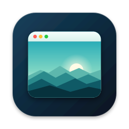
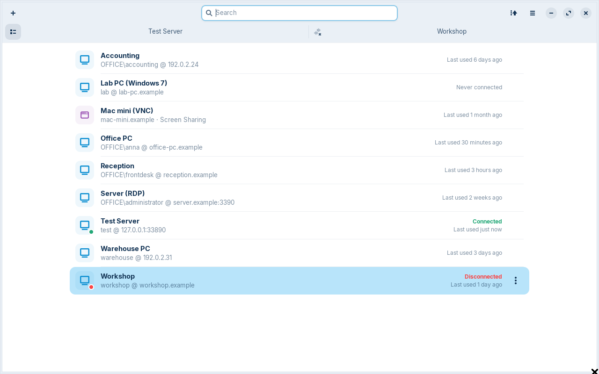
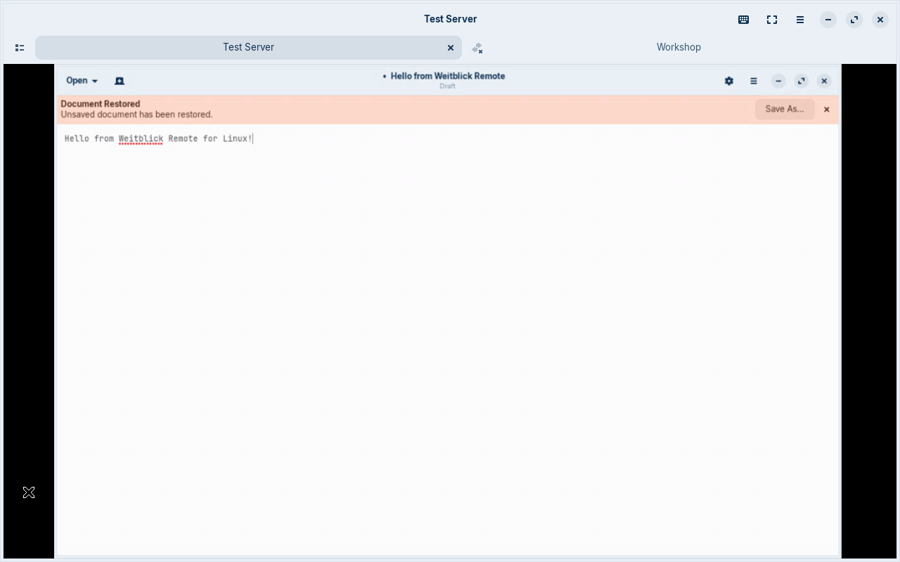
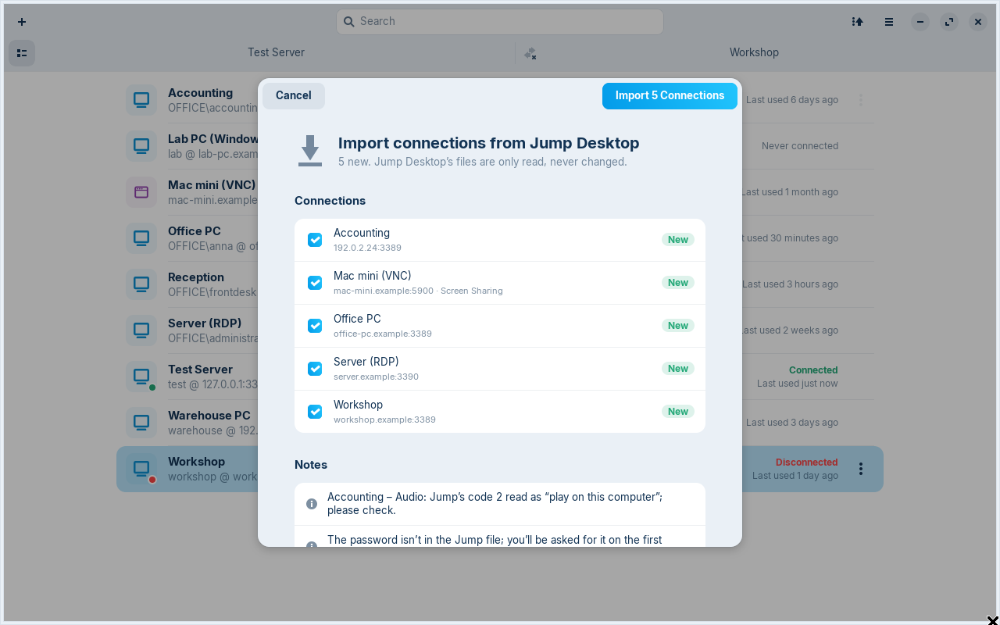

<p align="center">
  
</p>

<h1 align="center">Weitblick Remote for Linux</h1>

<p align="center">
  <strong>Remote Desktop for Windows PCs, now on Linux.</strong><br>
  The Linux version of <a href="../README.md">Weitblick Remote for macOS</a>, with GTK 4 and libadwaita, built on
  FreeRDP 3.
</p>

<p align="center">
  <a href="https://github.com/mneuhaus/weitblick-remote/releases/latest/download/Weitblick-Remote-amd64.deb"><strong>Download (.deb, amd64)</strong></a> ·
  <a href="https://github.com/mneuhaus/weitblick-remote/releases/latest/download/Weitblick-Remote-arm64.deb">arm64</a> ·
  <a href="https://github.com/mneuhaus/weitblick-remote/releases">All releases</a>
  <br>
  <sub>Ubuntu 24.04 or later · English and German interface · Apache-2.0</sub>
</p>

<p align="center">
  
</p>

## What it is

The macOS app is Swift/AppKit on top of a small C bridge to libfreerdp. The Linux version builds the same bridge
(`../Sources/WeitblickBridge`) and the same icon (`../design/icon`), and rebuilds everything above them in Python
with PyGObject: the same connection model and file
format, the same session logic (sign-in, certificate trust, reconnects, dynamic resolution), the clipboard, the
imports and the MCP server for AI agents. The runtime needs nothing beyond what a GNOME desktop already has.

## Features

- **Tabs like Jump:** an overview tab plus one tab per session; drag a tab out for its own window, or open every
  session in a separate window (Settings).
- **Keyboard made for Windows:** keys go to Windows as scancodes, so shortcuts, games and the Windows layout work as on
  a PC keyboard. The session's layout follows the local XKB layout (or a per-connection override).
  - *Smart typing* (default): characters typed with AltGr arrive as your layout shows them, even where layouts
    differ (on a German Mac layout `@` is AltGr+L, on the Windows German layout AltGr+Q).
  - *Characters as Unicode* for a remote layout that doesn't match, with local dead keys; *Physical keys only* for
    games.
  - Alt+Tab, Super and other desktop shortcuts reach Windows in full screen (or always/never, Settings), via GTK's
    shortcut inhibition. Ctrl+Alt+End sends Ctrl+Alt+Del, as in Microsoft's client.
  - Shortcuts with **Ctrl+Alt+Super** stay in the app (like ⌃⌥⌘ on the Mac): +F full screen, +←/→ and +1…9 switch
    tabs, +W disconnect.
- **Clipboard in both directions:** text, HTML, RTF, images, and files or whole folders (up to 2 GB per copy). Remote
  content is fetched only when an app pastes it; files land in `~/.cache/weitblick-remote/clipboard` on paste.
- **Folder sharing, sound, microphone, printers:** local folders as `\\tsclient\<name>` drives, sound through
  PulseAudio/PipeWire, CUPS printers in Windows.
- **Auto-reconnect** to the same Windows session after a network drop.
- **Imports:** Remmina (offered on the first start), Jump Desktop (`.jump` files copied from a Mac) and `.rdp` files
  (also by opening them in the file manager); export as `.rdp`.
- **Keyring:** passwords in the Secret Service (GNOME Keyring, KWallet), on this computer only.
- **Certificate trust:** see the fingerprint once, trust it permanently, get warned when it changes.
- **Wake-on-LAN**, **HiDPI** (full-resolution sessions that follow the window), **older Windows** (NLA off, TLS 1.0
  and classic RDP security as fallbacks), console sessions, alternate shell, load-balancer info.
- **AI agents (MCP):** Claude Code, Codex or any MCP client can use your connections – screenshots, mouse, keyboard,
  clipboard and on-screen text, all inside the RDP connection. See below.
- English and German interface.

<p align="center">
  
  
</p>

`connections.json` has the same format as the macOS app's file: copy
`~/Library/Application Support/Weitblick Remote/connections.json` from the Mac to `~/.config/weitblick-remote/` to take
your connections along (passwords stay in the Mac's keychain; you're asked once).

### Mac-style shortcuts

On the Mac, the app turns ⌘C into Ctrl+C. On Linux, Ctrl+C is already Ctrl+C. If you use
[Toshy](https://github.com/RedBearAK/toshy) for Mac shortcuts on Linux, it does that translation for this app too
(it isn't in Toshy's list of remote-desktop apps), so ⌘C, ⌘V, ⌘Z … arrive in Windows as Ctrl shortcuts – the
macOS app's default. To pass raw keys instead, add `nrw.neuhaus.WeitblickRemote` to `remotes` in
`~/.config/toshy/toshy_config.py`.

## Install

Ubuntu 24.04 or newer (also Zorin OS 18, Mint 22, Pop!_OS 24.04): download `Weitblick-Remote-amd64.deb` (or
`Weitblick-Remote-arm64.deb`) from the [latest release](https://github.com/mneuhaus/weitblick-remote/releases/latest)
and install it; apt pulls in GTK 4, libadwaita and FreeRDP 3 from the distribution:

```sh
sudo apt install ./Weitblick-Remote-amd64.deb
```

From source:

```sh
sudo apt install python3-gi gir1.2-gtk-4.0 gir1.2-adw-1 gir1.2-secret-1 libfreerdp-client3-3 \
                 build-essential freerdp3-dev libwinpr3-dev
git clone https://github.com/mneuhaus/weitblick-remote.git && cd weitblick-remote/linux
make
make install          # into ~/.local; or: make install PREFIX=/usr/local (as root)
weitblick-remote
```

Without root you can skip the two `-dev` packages: `make headers` downloads them with `apt-get download` and unpacks
the headers into `build/sysroot`. The app needs GTK 4.14, libadwaita 1.5 and FreeRDP 3 as in Ubuntu 24.04 (with updates) or newer. `make uninstall`
removes it again; `make deb` builds the package into `build/deb/`.

Optional: `sudo apt install tesseract-ocr tesseract-ocr-deu` for the agents' `read_screen` and `find_text`.

## Use with AI agents (MCP)

1. Turn on **Settings → AI Agents**. It is off by default; while it is off, nothing listens.
2. Add the server to your agent. For Claude Code:

   ```sh
   claude mcp add weitblick -- ~/.local/bin/weitblick-mcp
   ```

   `weitblick-mcp` talks to the app over a socket only your user can open
   (`$XDG_RUNTIME_DIR/weitblick-remote/mcp.sock`) and starts the app in the background if it isn't running.

Each connection has **AI agent access** (Edit… → Security): **Ask** (the default), **Always allow** or **Never**. Ask
shows a small prompt naming the agent and the PC: **Deny**, **Allow once**, **Allow for 10 minutes**, **Allow today** or
**Always allow**. Agent sessions run without a tab, with a 1280×800 desktop unless the agent asks for another size;
the overview marks them and offers **Watch**. **Take over** in a watched session pauses the agent until **Resume
agent**. Agents can't accept unknown certificates and don't ask for passwords: connect once by hand first. Every call
is logged to `~/.local/state/weitblick-remote/agent.log` (typed text by length only).

Tools: `list_connections`, `list_sessions`, `connect`, `disconnect`, `screenshot`, `click`, `mouse_move`, `mouse_down`,
`mouse_up`, `drag`, `scroll`, `type_text`, `key`, `clipboard_get`, `clipboard_set`, `wait`, `wait_for_screen`,
`read_screen`, `find_text`.

## Files

| What | Where |
| --- | --- |
| Connections | `~/.config/weitblick-remote/connections.json` |
| Settings | `~/.config/weitblick-remote/settings.json` |
| Passwords | Secret Service (login keyring), schema `nrw.neuhaus.WeitblickRemote` |
| FreeRDP state | `~/.local/share/weitblick-remote/FreeRDP/` |
| Agent audit log | `~/.local/state/weitblick-remote/agent.log` |
| MCP socket | `$XDG_RUNTIME_DIR/weitblick-remote/mcp.sock` |

No telemetry, no analytics, no account, no cloud.

## Development

```sh
make            # the bridge (build/libweitblick-bridge.so), the icons and the German translation
make test       # unit tests (no display needed)
make deb        # the Debian package (build/deb/)
make run        # the app from the source tree
scripts/dev-test-server.sh     # a local RDP server on 127.0.0.1:33890 (FreeRDP shadow on a private Xvfb)
scripts/update-po.py           # refresh po/weitblick-remote.pot and po/de.po after string changes
```

| macOS original | Linux port |
| --- | --- |
| `Sources/WeitblickBridge` (C) | the same files, built as `build/libweitblick-bridge.so` (`#ifdef` for the OS type) |
| `WeitblickKit` (RDPSession, clipboard) | `weitblick/rdp/session.py` (ctypes in `weitblick/bridge.py`), `weitblick/clipboard/` |
| `Packages/KeyboardEngine` | `weitblick/keyboard/` (evdev scancodes, XKB → Windows layout, chords) |
| `Packages/ConnectionStore` | `weitblick/store/` (+ Remmina import, Secret Service) |
| `Packages/AgentControl`, `Agent/` | `weitblick/agent/`, `weitblick/mcp_helper.py` |
| AppKit/SwiftUI app | `weitblick/app.py`, `weitblick/ui/` (GTK 4, libadwaita) |

## Known limits

No RD Gateway, multi-monitor or H.264 yet (as in the original); sign-in with user name and password only; files via
copy and paste, not drag and drop; read-only shared folders are not supported. Remote files are offered as
`text/uri-list`, which Nautilus and most GTK 4 apps paste; some older file managers only paste their own format.
On Wayland, passing Alt+Tab/Super to Windows needs the compositor's permission (GNOME asks once).

## License

[Apache License 2.0](../LICENSE). The macOS app and the C bridge © 2026 Marc Neuhaus. Third-party software:
[THIRD_PARTY_NOTICES.md](THIRD_PARTY_NOTICES.md).
